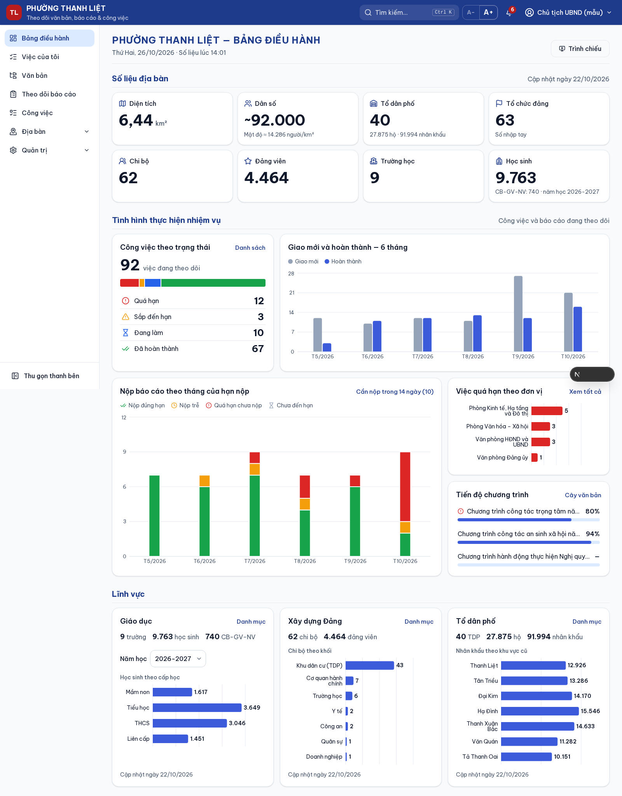
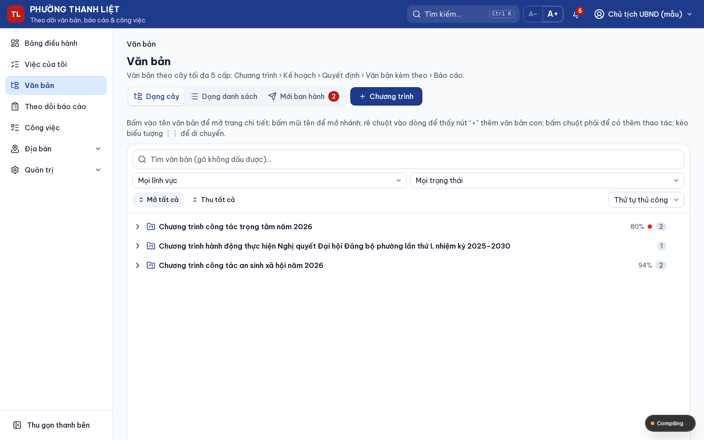
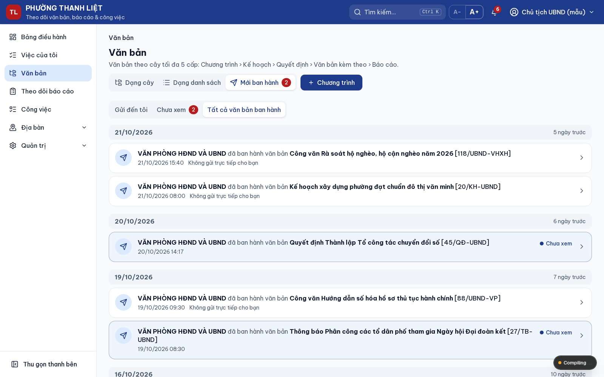
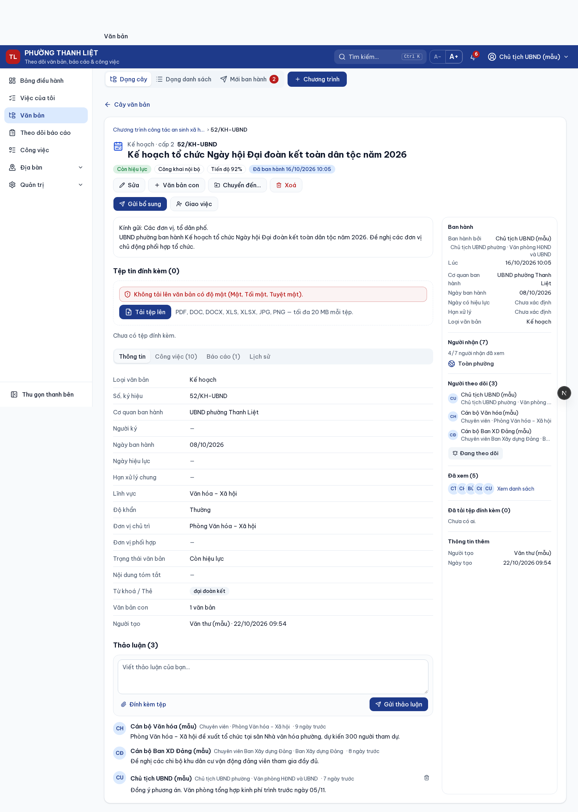
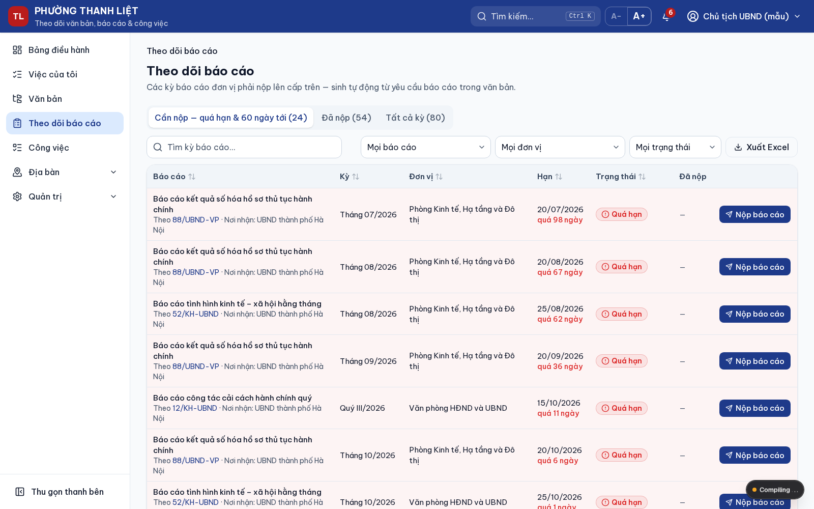
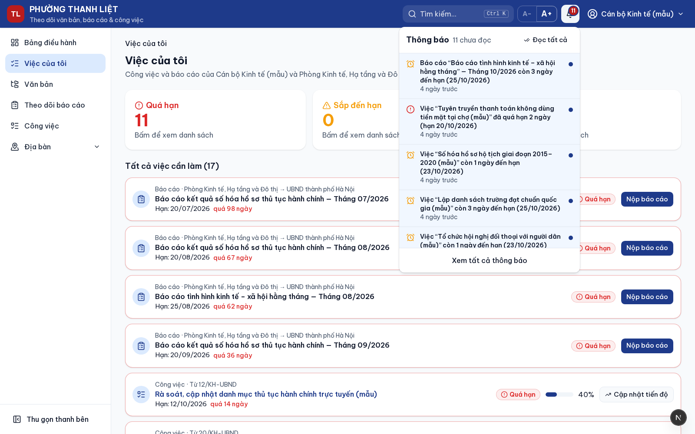
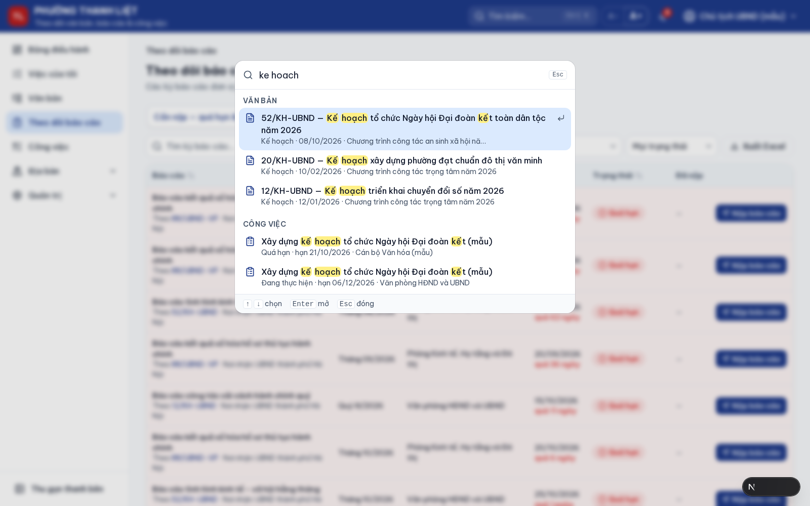
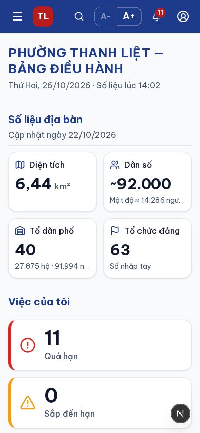

# Hệ thống theo dõi văn bản, báo cáo & công việc — Phường Thanh Liệt

Công cụ nội bộ giúp UBND và Đảng ủy phường **lưu trữ – tra cứu văn bản theo cây chương trình, ban hành văn bản tới các đơn vị, giao và theo dõi công việc, theo dõi hạn nộp báo cáo**, đồng thời cung cấp **Bảng điều hành** cho lãnh đạo xem nhanh số liệu địa bàn và tình hình thực hiện nhiệm vụ.

> **Phạm vi:** đây là công cụ **theo dõi – tổng hợp nội bộ**, không thay thế hệ thống quản lý văn bản điều hành chính thức (iOffice), không ký số, không liên thông văn bản điện tử. **Không lưu văn bản mật** (Mật, Tối mật, Tuyệt mật): mọi chỗ tải tệp lên đều có cảnh báo này.

Giao diện 100% tiếng Việt, chữ lớn (16px, có nút **A− / A+**), dùng được trên máy tính, máy tính bảng và điện thoại. Phù hợp cán bộ 30–60 tuổi.



---

## Mục lục

1. [Chức năng](#chức-năng)
2. [Vai trò và quyền](#vai-trò-và-quyền)
3. [Quy ước trạng thái theo hạn](#quy-ước-trạng-thái-theo-hạn)
4. [Công nghệ](#công-nghệ)
5. [Cài đặt và chạy](#cài-đặt-và-chạy)
6. [Kiểm thử](#kiểm-thử)
7. [Cấu trúc thư mục](#cấu-trúc-thư-mục)
8. [Tình trạng dự án](#tình-trạng-dự-án)

---

## Chức năng

### 1. Bảng điều hành (trang chủ)

Màn hình tổng quan cho lãnh đạo, **đọc trong 5 giây**, chia 3 khối. **Con số và cột biểu đồ nào cũng bấm được**, dẫn tới danh sách chi tiết đã lọc sẵn.

| Khối                             | Nội dung                                                                                                                                                                                                                                                            |
| -------------------------------- | ------------------------------------------------------------------------------------------------------------------------------------------------------------------------------------------------------------------------------------------------------------------- |
| **Số liệu địa bàn**              | 8 thẻ: Diện tích, Dân số (kèm mật độ), Tổ dân phố (kèm số hộ, nhân khẩu), Tổ chức đảng, Chi bộ, Đảng viên, Trường học, Học sinh (kèm số CB-GV-NV). Có ghi "Cập nhật ngày …" và đánh dấu "Số nhập tay" khi số liệu đảng được nhập thủ công.                          |
| **Tình hình thực hiện nhiệm vụ** | Công việc theo trạng thái (Quá hạn / Sắp đến hạn / Đang làm / Đã hoàn thành); biểu đồ **Giao mới và hoàn thành 6 tháng**; biểu đồ **Nộp báo cáo theo tháng** (đúng hạn / trễ / quá hạn / chưa đến hạn); **Việc quá hạn theo đơn vị**; **Tiến độ các chương trình**. |
| **Lĩnh vực**                     | Giáo dục (học sinh theo cấp học, **chọn được năm học**), Xây dựng Đảng (chi bộ theo khối), Tổ dân phố (nhân khẩu theo khu vực cũ).                                                                                                                                  |

- **Theo vai trò:** lãnh đạo, văn thư, Ban XD Đảng thấy đầy đủ. Cán bộ thấy bản rút gọn kèm khối "Việc của tôi". Người chỉ xem không thấy khối công việc nội bộ.
- **Trình chiếu** (`/trinh-chieu`): toàn màn hình, chữ to hơn, đồng hồ, **tự làm mới 5 phút/lần**. Dùng để chiếu lên TV phòng họp giao ban.

### 2. Văn bản

#### Cây văn bản 5 cấp

Văn bản được tổ chức thành cây tối đa **5 cấp**, cấp 1 luôn là **Chương trình**. Ví dụ: Chương trình › Kế hoạch › Quyết định › Văn bản kèm theo › Báo cáo.

- **Trang Văn bản** hiển thị cây chiếm cả màn hình. Bấm vào tên văn bản để mở **trang chi tiết riêng** (có nút "← Cây văn bản", quay lại vẫn giữ các nhánh đang mở).
- **Thêm, sửa, xoá, di chuyển:**
  - Nút "+" trên từng dòng, menu chuột phải.
  - **Kéo – thả** để chuyển nhánh hoặc sắp xếp. Có cách thay thế bằng bàn phím: "Chuyển đến…".
  - Hệ thống **chặn vượt quá 5 cấp** và chặn kéo một nhánh vào chính con cháu của nó, kèm thông báo nói rõ lý do.
- **Tiến độ cộng dồn:** mỗi nhánh hiện % hoàn thành tính từ các công việc bên dưới, kèm **chấm đỏ** khi trong nhánh có việc quá hạn.
- **Tìm không dấu:** gõ "quyet dinh thanh lap" vẫn ra "Quyết định … Thành lập …". Kết quả được tô vàng và cây tự mở tới đúng văn bản. Lọc được theo lĩnh vực và trạng thái hiệu lực.
- **Dạng danh sách:** bảng phẳng có cột Cấp, lọc theo chương trình, loại, lĩnh vực; **xuất Excel cây** thụt lề theo cấp.
- **Xoá mềm:** văn bản xoá chuyển vào Thùng rác (giữ 30 ngày). Xoá nút còn con phải xác nhận "Xoá cả nhánh"; có nút **Hoàn tác** ngay sau khi xoá.



#### Thông tin và tệp đính kèm

- Đủ các trường: số/ký hiệu, loại, trích yếu, cơ quan ban hành, người ký, ngày ban hành, ngày hiệu lực, hạn xử lý, lĩnh vực, độ khẩn, đơn vị chủ trì/phối hợp, trạng thái hiệu lực (còn hiệu lực / hết hiệu lực / bị thay thế), nội dung tóm tắt, từ khoá.
- **Đính kèm nhiều tệp** PDF, Word, Excel, ảnh (tối đa 20 MB/tệp). Hệ thống kiểm tra đúng định dạng thật của tệp, không chỉ xem đuôi.
- **Xem trước ngay trên trang:** PDF, ảnh, **Word (.docx)** và **Excel (.xlsx)**, có nút "Mở lớn". Tệp .doc/.xls đời cũ chỉ tải về.
- **Lịch sử** thay đổi của văn bản. Lãnh đạo/quản trị mở được nhật ký đầy đủ kèm nội dung trước → sau.

#### Ban hành / gửi văn bản

- Nút **"Ban hành / Gửi"**: chọn người nhận là **Toàn phường**, một hoặc nhiều **đơn vị**, hoặc **từng cá nhân** (có ô tìm theo tên), kèm **lời gửi** ("Kính gửi: …").
- Người nhận có thông báo kiểu: _"VĂN PHÒNG HĐND VÀ UBND đã ban hành văn bản Quyết định … [45/QĐ-UBND]"_.
- **Người nhận ở mọi vai trò đều được xem chi tiết và tải tệp**, kể cả cán bộ đơn vị khác và tổ trưởng TDP.
- **"Gửi bổ sung":** chỉ người nhận mới được báo; mốc ban hành lần đầu giữ nguyên.
- **Trang "Mới ban hành":** dòng thời gian theo ngày ("Hôm nay", "Hôm qua"…), lọc _Gửi đến tôi / Chưa xem / Tất cả_; số văn bản gửi đến chưa xem hiện trên tab.



#### Người nhận, người theo dõi, thảo luận

Cột thông tin bên phải trang văn bản gồm:

- Ban hành bởi, các mốc ngày.
- **Người nhận** (theo đơn vị, kèm "x/y người nhận đã xem").
- **Người theo dõi** kèm nút **Theo dõi**.
- **Đã xem (N)** và **Đã tải tệp đính kèm (N)**.

Phần **Thảo luận** cuối trang: ai xem được văn bản đều viết được, có thể đính kèm tệp. Người theo dõi, người tạo và người ban hành được báo khi có thảo luận mới. Theo dõi một văn bản thì cũng được báo khi có văn bản mới trong nhánh đó.



### 3. Công việc

- **Giao việc** từ một văn bản hoặc giao riêng: người/đơn vị chủ trì, đơn vị/cá nhân phối hợp, hạn, mức ưu tiên.
- **Luồng xử lý:** Mới giao → Đang thực hiện → Báo hoàn thành (chờ duyệt) → Người giao **duyệt** hoặc **trả lại** → Đã hoàn thành. Có thể huỷ việc.
- **Cập nhật tiến độ** (%) kèm nội dung và **tệp minh chứng**.
- **Đề nghị gia hạn:** người giao đồng ý hoặc từ chối.
- **Danh sách công việc:** lọc theo trạng thái, bước xử lý, đơn vị chủ trì, tháng giao/tháng hoàn thành; xuất Excel. Mỗi người chỉ thấy việc trong phạm vi của mình.

### 4. Theo dõi báo cáo

- **Yêu cầu báo cáo** gắn với văn bản: báo cáo **một lần** hoặc **định kỳ** (hằng tháng, quý, 6 tháng, năm), ngày hạn trong kỳ, các đơn vị phải nộp, nơi nhận, người theo dõi.
- Hệ thống **tự sinh các kỳ báo cáo** cho từng đơn vị. Ví dụ: báo cáo hằng tháng ngày 20, từ 01/2026 đến 12/2026, cho 3 đơn vị → 36 kỳ. Form xem trước số kỳ trước khi tạo.
- **Nộp báo cáo:** số/ký hiệu, ngày gửi, tệp báo cáo. Nộp sau hạn hiện **"Đã nộp trễ"**. Bản nộp có thể tự trở thành văn bản con trên cây; sửa được trong 24 giờ, sau đó cần lãnh đạo mở khoá.
- **Trang Theo dõi báo cáo:** tab Cần nộp / Đã nộp / Tất cả kỳ, lọc theo yêu cầu, đơn vị, trạng thái, tháng của hạn nộp; xuất Excel.



### 5. Việc của tôi

Trang mặc định của cán bộ, liệt kê **mọi công việc và kỳ báo cáo** của cá nhân và đơn vị mình, xếp theo hạn gần nhất. Mỗi dòng có nút thao tác nhanh: cập nhật tiến độ, nộp báo cáo, duyệt.



### 6. Thông báo và nhắc hạn tự động

- **Chuông thông báo** trên đầu trang: số chưa đọc, 10 thông báo mới nhất, "Đọc tất cả". Trang **Thông báo** xem toàn bộ, lọc chưa đọc.
- **Sự kiện có thông báo:**
  - Được giao việc; việc bị trả lại; việc được duyệt; việc bị huỷ.
  - Có việc chờ duyệt; có đề nghị gia hạn và kết quả gia hạn.
  - Đơn vị phải báo cáo; báo cáo đã được nộp.
  - Văn bản được ban hành tới mình; có văn bản mới hoặc thảo luận mới trong văn bản mình theo dõi.
- **Nhắc hạn tự động lúc 06:30 hằng ngày:**
  - Việc và kỳ báo cáo **còn 3 ngày**, **còn 1 ngày** đến hạn.
  - **Quá hạn:** nhắc mỗi ngày, tối đa 7 ngày. Ngày đầu quá hạn báo thêm người giao việc hoặc người theo dõi báo cáo.
  - Chạy lại trong ngày không sinh thông báo trùng.
- **Job đêm (00:15):** tính lại tiến độ toàn bộ cây, xoá vĩnh viễn mục trong Thùng rác quá 30 ngày, dọn thông báo đã đọc quá 90 ngày.
- Nếu máy chủ bật lại sau giờ chạy, hệ thống tự **chạy bù** trong ngày.

### 7. Tìm kiếm toàn hệ thống (Ctrl + K)

Bấm **Ctrl + K** (hoặc ô "Tìm kiếm…" trên đầu trang), gõ không dấu.

- Kết quả chia nhóm: **Văn bản, Công việc, Trường học, Tổ dân phố, Tổ chức đảng**, có tô sáng từ khoá.
- Dùng phím ↑ ↓ để chọn, Enter để mở.
- Mỗi người chỉ thấy kết quả trong phạm vi được xem.



### 8. Danh mục địa bàn

| Danh mục             | Nội dung                                                                                           |
| -------------------- | -------------------------------------------------------------------------------------------------- |
| **Thông tin phường** | Diện tích, dân số (đánh dấu số ước tính), số liệu đảng nhập tay khi danh mục chưa đủ.              |
| **Trường học**       | Danh sách trường theo cấp học, loại hình; **số liệu theo từng năm học** (CB-GV-NV, lớp, học sinh). |
| **Tổ dân phố**       | Số hộ, nhân khẩu, khu vực cũ (trước sáp nhập), chi bộ phụ trách.                                   |
| **Tổ chức đảng**     | Cây Đảng bộ – chi bộ; số đảng viên tự cộng từ chi bộ; lọc theo loại và khối.                       |

- Thêm/sửa/xoá trên giao diện; **nhập từ Excel** theo file mẫu tải về. File lỗi được báo **từng dòng, từng cột** và không ghi gì vào hệ thống (tất cả hoặc không).
- **Xuất Excel** cho mọi bảng.

### 9. Quản trị

- **Người dùng:** tạo tài khoản, gán vai trò (một người có thể nhiều vai trò) và đơn vị, khoá/mở, đặt lại mật khẩu.
- **Đơn vị** và các **danh mục dùng chung:** loại văn bản, lĩnh vực, cơ quan ban hành, khu vực cũ.
- **Nhật ký hệ thống** (quản trị, lãnh đạo):
  - Mọi thao tác ghi, đăng nhập (kể cả đăng nhập sai), tải tệp, xuất dữ liệu, ban hành, xoá vĩnh viễn.
  - Lọc theo người, đối tượng, hành động, khoảng ngày; xem nội dung trước → sau; xuất Excel.
- **Thùng rác** (quản trị):
  - Văn bản và tệp đã xoá, kèm số ngày còn lại trước khi tự xoá; **khôi phục** hoặc **xoá vĩnh viễn** (có xác nhận hậu quả).
  - Hiển thị tình trạng các tác vụ tự động chạy lần gần nhất.

### 10. Bảo mật và dễ dùng

- **Đăng nhập:** mật khẩu mã hoá (bcrypt); **khoá tài khoản 15 phút sau 5 lần sai**; **bắt đổi mật khẩu ở lần đăng nhập đầu**; phiên làm việc 8 giờ.
- **Phân quyền tập trung** theo vai trò và theo từng văn bản/công việc, áp dụng cho cả giao diện lẫn API.
- **Tệp đính kèm** chỉ tải được qua đường dẫn có kiểm tra quyền. Mỗi lần xem/tải đều được ghi nhật ký.
- **Thông báo lỗi** luôn là câu tiếng Việt dễ hiểu kèm mã hỗ trợ ngắn, không hiện lỗi kỹ thuật.
- **Cỡ chữ A− / A+** được ghi nhớ theo tài khoản.
- **Giao diện điện thoại:** menu thu gọn, bảng chuyển thành dạng thẻ.
- **Trạng thái** luôn có màu **kèm chữ và biểu tượng**, không phụ thuộc vào màu.

<p align="center"></p>

---

## Vai trò và quyền

| Chức năng                  | Quản trị | Lãnh đạo |   Văn thư   |                                             Cán bộ                                              |   Ban XD Đảng    |         Chỉ xem          |
| -------------------------- | :------: | :------: | :---------: | :---------------------------------------------------------------------------------------------: | :--------------: | :----------------------: |
| Bảng điều hành             |  đầy đủ  |  đầy đủ  |   đầy đủ    |                                     rút gọn + Việc của tôi                                      |      đầy đủ      | không có khối công việc  |
| Xem văn bản                |  tất cả  |  tất cả  |   tất cả    | đơn vị mình chủ trì/phối hợp, việc của mình, văn bản công khai nội bộ, **văn bản được gửi tới** |      tất cả      | **văn bản được gửi tới** |
| Tạo/sửa văn bản, ban hành  |    ✔     |    ✔     |      ✔      |                                                ✗                                                | lĩnh vực XD Đảng |            ✗             |
| Xoá văn bản                |    ✔     |    ✔     | do mình tạo |                                                ✗                                                |   do mình tạo    |            ✗             |
| Giao việc                  |    ✔     |    ✔     |      ✔      |                                                ✗                                                |        ✔         |            ✗             |
| Cập nhật tiến độ           |    ✔     |    ✔     |      ✔      |                                      việc của mình/đơn vị                                       |  việc của mình   |            ✗             |
| Duyệt hoàn thành / gia hạn |    ✔     |    ✔     | người giao  |                                                ✗                                                |    người giao    |            ✗             |
| Tạo yêu cầu báo cáo        |    ✔     |    ✔     |      ✔      |                                                ✗                                                |        ✔         |            ✗             |
| Nộp báo cáo                |    ✔     |    ✔     |      ✔      |                                           đơn vị mình                                           |   đơn vị mình    |            ✗             |
| Danh mục trường, TDP       |    ✔     |   xem    |      ✔      |                                               xem                                               |       xem        |           xem            |
| Danh mục tổ chức đảng      |    ✔     |   xem    |     xem     |                                               xem                                               |        ✔         |           xem            |
| Người dùng, cấu hình       |    ✔     |    ✗     |      ✗      |                                                ✗                                                |        ✗         |            ✗             |
| Nhật ký                    |    ✔     |    ✔     |      ✗      |                                                ✗                                                |        ✗         |            ✗             |
| Thùng rác (quản trị)       |    ✔     |    ✗     |      ✗      |                                                ✗                                                |        ✗         |            ✗             |

Một người có nhiều vai trò thì được hợp quyền của các vai trò đó.

## Quy ước trạng thái theo hạn

Trạng thái được **tính tự động** từ hạn và ngày hoàn thành (theo giờ Việt Nam), không sửa tay.

| Trạng thái                            | Màu         | Ý nghĩa                                |
| ------------------------------------- | ----------- | -------------------------------------- |
| Quá hạn                               | đỏ          | Đã qua hạn, chưa hoàn thành / chưa nộp |
| Sắp đến hạn                           | vàng        | Còn ≤ 3 ngày (cấu hình được)           |
| Đang thực hiện / Chưa đến hạn         | xanh dương  | Còn hạn                                |
| Hoàn thành đúng hạn / Đã nộp đúng hạn | xanh lá     | Xong trong ngày hạn hoặc trước         |
| Hoàn thành trễ / Đã nộp trễ           | xanh lá đậm | Xong sau hạn                           |
| Không có hạn                          | xám         | Việc không đặt hạn                     |

Việc đã báo hoàn thành và đang chờ duyệt không bị tính là quá hạn do chậm duyệt.

---

## Công nghệ

| Thành phần     | Công nghệ                                                                          |
| -------------- | ---------------------------------------------------------------------------------- |
| Ứng dụng web   | Next.js 16 (App Router), React 19, TypeScript                                      |
| Giao diện      | Tailwind CSS 4, shadcn/ui (Radix), lucide-react, recharts, TanStack Table, dnd-kit |
| Cơ sở dữ liệu  | PostgreSQL 14+ (extension `unaccent`, `pg_trgm`) qua Prisma 7                      |
| Đăng nhập      | Auth.js (Credentials), bcrypt                                                      |
| Tác vụ định kỳ | Tiến trình worker riêng với node-cron (giờ Việt Nam)                               |
| Excel / Word   | exceljs (nhập, xuất, xem trước), docx-preview (xem trước Word)                     |
| Kiểm thử       | Vitest (unit, integration), Playwright (e2e ở 1920 / 1366 / 390px)                 |

## Cài đặt và chạy

### Yêu cầu

- Node.js **≥ 20.19**
- PostgreSQL **14 trở lên**, có extension `unaccent` và `pg_trgm`.

Có thể dùng `docker compose up -d db` (PostgreSQL 16), hoặc trên máy không có Docker thì dùng script `npm run db:local -- init` (PostgreSQL chạy dưới quyền người dùng, không cần sudo).

### Các bước

```bash
git clone https://github.com/huehoang-204/theo-doi-van-ban-thanh-liet.git
cd theo-doi-van-ban-thanh-liet

cp .env.example .env        # sửa DATABASE_URL, AUTH_SECRET (openssl rand -base64 32), UPLOAD_DIR
npm install                 # tự sinh Prisma client

npm run db:local -- init    # (tuỳ chọn) tạo PostgreSQL cục bộ không cần Docker
npm run db:deploy           # tạo bảng
npm run db:seed             # dữ liệu nền + dữ liệu mẫu (đặt SEED_SAMPLE=0 để bỏ dữ liệu mẫu)

npm run dev                 # http://localhost:3250
npm run worker              # (cửa sổ khác) tác vụ tự động: nhắc hạn 06:30, job đêm 00:15
```

Kiểm tra nhanh: `curl http://localhost:3250/api/health` → `{"status":"ok","db":"ok"}`.

### Tài khoản dùng thử (dữ liệu mẫu)

Mật khẩu chung **`ThanhLiet@2026`**. Lần đăng nhập đầu hệ thống bắt đổi mật khẩu.

| Tài khoản          | Vai trò                                                      |
| ------------------ | ------------------------------------------------------------ |
| `bithu`, `chutich` | Lãnh đạo                                                     |
| `vanthu`           | Văn thư                                                      |
| `canbo1`, `canbo2` | Cán bộ                                                       |
| `xaydungdang`      | Ban Xây dựng Đảng                                            |
| `totruong1`        | Chỉ xem (tổ trưởng TDP)                                      |
| `admin`            | Quản trị (mật khẩu theo biến `SEED_ADMIN_PASSWORD` khi seed) |

Dữ liệu mẫu gồm 9 trường, 40 tổ dân phố (~92.000 nhân khẩu), 63 tổ chức đảng, 14 văn bản (6 đã ban hành), 3 yêu cầu báo cáo và khoảng 90 công việc rải trong 6 tháng gần nhất. Dữ liệu mẫu được đánh dấu riêng. **Trước khi dùng thật, xoá bằng `npm run db:clear-sample`**; dữ liệu thật không bị ảnh hưởng.

### Lệnh thường dùng

| Lệnh                                            | Tác dụng                                                    |
| ----------------------------------------------- | ----------------------------------------------------------- |
| `npm run dev`                                   | Chạy ứng dụng (phát triển) tại cổng 3250                    |
| `npm run build` / `npm run start`               | Đóng gói và chạy bản production                             |
| `npm run worker`                                | Chạy tác vụ tự động theo lịch                               |
| `npm run worker -- --once all`                  | Chạy ngay một lần (`daily`, `nightly` hoặc `all`) rồi thoát |
| `npm run db:migrate`                            | Tạo/áp migration khi sửa schema                             |
| `npm run db:seed`                               | Nạp dữ liệu nền + mẫu                                       |
| `npm run db:clear-sample`                       | Xoá toàn bộ dữ liệu mẫu                                     |
| `npm run db:local -- start\|stop\|status\|psql` | Quản lý PostgreSQL cục bộ                                   |

## Kiểm thử

```bash
npm run lint && npm run typecheck
npm run test                # unit test (logic nghiệp vụ thuần)
npm run test:integration    # chạy server action thật trên CSDL riêng <db>_test
npm run test:e2e            # Playwright, CSDL riêng <db>_e2e, server riêng cổng 3251
```

Logic nghiệp vụ được viết thành hàm thuần và có unit test trước khi đưa vào giao diện: trạng thái theo hạn, sinh kỳ báo cáo, cây văn bản, tiến độ cộng dồn, phân quyền, nhắc hạn, Thùng rác, ban hành. Bộ e2e chạy trên dữ liệu riêng, không đụng dữ liệu đang dùng. Bộ này kiểm các tiêu chí nghiệm thu như:

- cây đủ 5 cấp;
- 36 kỳ báo cáo và "Đã nộp trễ";
- số trên Bảng điều hành khớp danh mục;
- việc còn 3 ngày thì người chủ trì có thông báo sáng hôm đó.

## Cấu trúc thư mục

```
├─ prisma/              schema, migrations, dữ liệu nền (seed.ts), dữ liệu mẫu (seed-sample.ts)
├─ src/
│  ├─ app/              các trang (URL tiếng Việt: /van-ban, /viec-cua-toi, /bao-cao, /cong-viec,
│  │                    /dia-ban/…, /quan-tri/…, /trinh-chieu) và API (/api/…)
│  ├─ components/       giao diện theo khu vực (dashboard, document-tree, tasks, reports, catalog…)
│  ├─ lib/              logic nghiệp vụ thuần + phân quyền + định dạng số/ngày kiểu Việt Nam
│  ├─ server/           truy vấn, server action (ghi dữ liệu + nhật ký), tác vụ định kỳ
│  └─ worker/           tiến trình chạy lịch 06:30 và 00:15
├─ tests/               unit/, integration/, e2e/
├─ scripts/dev/         PostgreSQL cục bộ không cần Docker
├─ docs/                câu hỏi mở / quyết định nghiệp vụ, ảnh minh hoạ
├─ he-thong-theo-doi-van-ban-phuong-thanh-liet.md   đặc tả hệ thống
└─ CLAUDE.md            ghi chú kỹ thuật cho người phát triển
```

## Tình trạng dự án

| Giai đoạn | Nội dung                                                                                                       | Tình trạng                                       |
| --------- | -------------------------------------------------------------------------------------------------------------- | ------------------------------------------------ |
| 0         | Khởi tạo, giao diện khung                                                                                      | ✅ Xong                                          |
| 1         | Đăng nhập, người dùng, danh mục, nhập/xuất Excel                                                               | ✅ Xong                                          |
| 2         | Cây văn bản 5 cấp, tệp đính kèm, tìm không dấu                                                                 | ✅ Xong                                          |
| 3         | Công việc, yêu cầu và kỳ báo cáo, Việc của tôi                                                                 | ✅ Xong                                          |
| 4         | Bảng điều hành, Trình chiếu                                                                                    | ✅ Xong (đã thiết kế lại gọn hơn, nhiều biểu đồ) |
| 5         | Thông báo, nhắc hạn tự động, Ctrl+K, Nhật ký, Thùng rác                                                        | ✅ Xong                                          |
| 5b        | Ban hành văn bản, xem trước Word/Excel, thảo luận                                                              | ✅ Xong                                          |
| 6         | Hoàn thiện & triển khai: hướng dẫn sử dụng, in ấn, đóng gói production (Docker cho ứng dụng + worker), sao lưu | ⏳ Chưa làm                                      |
| 7         | Mở rộng sau dùng thử: bản đồ, email/Zalo, nhân bản chương trình, báo cáo Word tự động                          | ⏳ Chưa làm                                      |

Các điểm nghiệp vụ còn chờ phường xác nhận và các quyết định đã áp dụng mặc định được ghi tại [`docs/cau-hoi-mo.md`](docs/cau-hoi-mo.md). Đặc tả đầy đủ ở [`he-thong-theo-doi-van-ban-phuong-thanh-liet.md`](he-thong-theo-doi-van-ban-phuong-thanh-liet.md).
